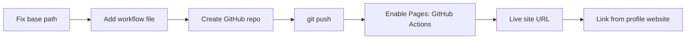

# Put your 3D hero on GitHub Pages

This turns the project into a live website at
`https://<your-github-username>.github.io/<repo-name>/`
that you can link from your profile website.

> [!NOTE]
> GitHub Pages only hosts static files. That is fine here: `npm run build` turns
> the project into plain HTML, CSS and JavaScript in `dist/`, and Three.js runs
> in the visitor's browser.

## Contents

- [Before you start](#before-you-start)
- [Step 1: Make asset paths work on GitHub Pages](#step-1-make-asset-paths-work-on-github-pages)
- [Step 2: Add the deploy workflow](#step-2-add-the-deploy-workflow)
- [Step 3: Create the GitHub repository](#step-3-create-the-github-repository)
- [Step 4: Push the project](#step-4-push-the-project)
- [Step 5: Turn on GitHub Pages](#step-5-turn-on-github-pages)
- [Step 6: Link it from your profile website](#step-6-link-it-from-your-profile-website)
- [Updating the site later](#updating-the-site-later)
- [Troubleshooting](#troubleshooting)

## Before you start

- [ ] A GitHub account (https://github.com)
- [ ] Git installed: run `git --version` in a terminal
- [ ] The project runs locally (`npm run dev`) and `npm run build` finishes without errors



## Step 1: Make asset paths work on GitHub Pages

A Pages site lives in a sub-folder (`/<repo-name>/`), not at the root. Vite's
default absolute paths would break. Setting `base: './'` makes every path
relative, so it works whatever you name the repo.

Create a file called `vite.config.ts` in the **project root** (next to `package.json`):

```ts
import { defineConfig } from 'vite'

export default defineConfig({
  // Relative paths so the site works under https://user.github.io/<repo>/
  base: './',
})
```

Also open `index.html` and change the favicon line from `/favicon.svg` to a relative path:

```html
<link rel="icon" type="image/svg+xml" href="favicon.svg" />
```

Check that it still builds and previews correctly:

```bash
npm run build
npm run preview
```

Open the URL it prints and make sure the hero appears.

## Step 2: Add the deploy workflow

This tells GitHub to build and publish your site automatically on every push.

Create the folders and file `.github/workflows/deploy.yml`:

```yaml
name: Deploy to GitHub Pages

on:
  push:
    branches: [main]
  workflow_dispatch: # lets you run it by hand from the Actions tab

permissions:
  contents: read
  pages: write
  id-token: write

concurrency:
  group: pages
  cancel-in-progress: true

jobs:
  build:
    runs-on: ubuntu-latest
    steps:
      - uses: actions/checkout@v4
      - uses: actions/setup-node@v4
        with:
          node-version: 22
          cache: npm
      - run: npm ci
      - run: npm run build
      - uses: actions/upload-pages-artifact@v3
        with:
          path: dist

  deploy:
    needs: build
    runs-on: ubuntu-latest
    environment:
      name: github-pages
      url: ${{ steps.deployment.outputs.page_url }}
    steps:
      - id: deployment
        uses: actions/deploy-pages@v4
```

> [!TIP]
> If a newer major version of one of these actions exists when you read this,
> GitHub will usually warn you in the Actions log. Bumping `@v4` to the newer
> number is safe.

## Step 3: Create the GitHub repository

1. Go to https://github.com/new
2. **Repository name:** for example `nova-strike` (the name becomes part of the URL)
3. Choose **Public** (free GitHub Pages needs a public repo on most plans)
4. **Do not** tick "Add a README", ".gitignore" or a license. The project already has files.
5. Click **Create repository** and keep the page open. You will need its URL.

## Step 4: Push the project

> [!WARNING]
> Your project folder sits inside a Git repository that starts at your **home
> folder** (`C:\Users\user`). If you run `git init` in the wrong place, you
> could upload personal files. Always run the commands below **inside the
> project folder**, and check with the first command.

Open the VS Code terminal in the project folder (**Ctrl + `**) and run:

```powershell
git rev-parse --show-toplevel
```

- If it prints your **home folder**, that is the outer repository. Continue below: `git init` creates a separate, new repository just for this project.
- If it prints the project folder, skip `git init`.

```powershell
git init -b main
```

Check what will be included. You should see `src`, `public`, `index.html`, `package.json` and so on, but **not** `node_modules` or `dist`:

```powershell
git status
```

Commit and connect it to GitHub (replace the URL with the one from Step 3):

```powershell
git add .
git commit -m "Initial commit: Nova Strike 3D hero"
git remote add origin https://github.com/<your-username>/<repo-name>.git
git push -u origin main
```

GitHub may open a browser window asking you to sign in the first time.

## Step 5: Turn on GitHub Pages

1. On your repository page, open **Settings**.
2. In the left menu click **Pages**.
3. Under **Build and deployment**, set **Source** to **GitHub Actions**.
4. Open the **Actions** tab. The "Deploy to GitHub Pages" run should be going (or click **Run workflow**).
5. Wait for the green check mark (usually 1 to 2 minutes).
6. Your site is live at:

```text
https://<your-username>.github.io/<repo-name>/
```

The exact link is also shown under **Settings > Pages** and on the finished
**deploy** job in the Actions tab.

## Step 6: Link it from your profile website

Add a link or button in your profile site's HTML:

```html
<a href="https://<your-username>.github.io/<repo-name>/" target="_blank" rel="noopener">
  View my 3D hero
</a>
```

Or embed it on a page of your profile site:

```html
<iframe
  src="https://<your-username>.github.io/<repo-name>/"
  title="Nova Strike 3D hero"
  width="100%"
  height="600"
  style="border:0"
  loading="lazy"
></iframe>
```

> [!TIP]
> If your profile website is itself a GitHub Pages site, a plain link is the
> simplest and works best on phones. Embedding in an iframe is optional.

## Updating the site later

Every time you change something, run:

```powershell
git add .
git commit -m "Describe your change"
git push
```

The workflow rebuilds and republishes automatically.

## Troubleshooting

| Problem | Fix |
| --- | --- |
| Blank page, console shows 404 for `/assets/...` | `base: './'` is missing. Redo [Step 1](#step-1-make-asset-paths-work-on-github-pages) and push again |
| `git push` is rejected or asks for a password | Sign in through the browser window, or use GitHub Desktop / a personal access token |
| Workflow fails at `npm ci` | Make sure `package-lock.json` is committed (not in `.gitignore`) |
| Workflow fails at `npm run build` with a TypeScript error | Run `npm run build` locally, fix the error, then push again |
| "Pages" option is missing in Settings | The repo may be private on a free plan: make it public |
| Site shows an old version | Hard refresh with **Ctrl + Shift + R**, then check the Actions tab for a failed run |
| `git status` lists hundreds of files from outside the project | You are in the outer home-folder repository. Run `git init -b main` inside the project folder |
