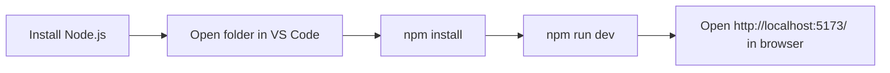

# Fernaniii – 3D hero showcase

A character showcase page for a 3D jetpack shooter, built with **Vite**, **TypeScript** and **Three.js**. The hero, "Fernaniii", is built entirely from Three.js primitives (no external models) and has four previewable abilities.

## Contents

- [How to get running](#how-to-get-running)
- [Prerequisites](#prerequisites)
- [Run it locally in VS Code](#run-it-locally-in-vs-code)
- [npm scripts](#npm-scripts)
- [Daily checklist](#daily-checklist)
- [Controls](#controls)
- [Project structure](#project-structure)
- [Troubleshooting](#troubleshooting)

## How to get running



## Prerequisites

- [ ] **VS Code**: https://code.visualstudio.com
- [ ] **Node.js LTS**: https://nodejs.org

Check that both Node.js and npm work by running these in a terminal:

```bash
node -v
npm -v
```

Each command should print a version number.

> [!NOTE]
> Choose the **LTS** version of Node.js. It is the most stable and works with Vite.

## Run it locally in VS Code

1. **Open the project folder.** In VS Code choose **File > Open Folder** and select this project's folder.
2. **Open the integrated terminal** with **Ctrl + `** (backtick) on Windows/Linux or **Cmd + `** on macOS.
3. **Install dependencies** (only needed the first time, or after `package.json` changes):

   ```bash
   npm install
   ```

4. **Start the dev server:**

   ```bash
   npm run dev
   ```

   The terminal prints something like:

   ```text
     VITE ready in 300 ms

     ➜  Local:   http://localhost:5173/
   ```

5. **Open the page.** Hold **Ctrl** (or **Cmd** on macOS) and click the `http://localhost:5173/` link, or paste it into your browser.
6. **Stop the server** with **Ctrl + C** in the terminal.

> [!TIP]
> Vite reloads the page automatically whenever you save a file, so keep the dev server running while you edit the code in `src/`.

## npm scripts

| Command | What it does |
| --- | --- |
| `npm run dev` | Starts the local dev server with live reload |
| `npm run build` | Type-checks and creates an optimized production build in `dist/` |
| `npm run preview` | Serves the production build locally so you can test it |

## Daily checklist

- [ ] Open the project folder in VS Code
- [ ] Open the terminal (**Ctrl + `**)
- [ ] Run `npm run dev`
- [ ] Open `http://localhost:5173/` in your browser

## Controls

| Input | Action |
| --- | --- |
| **Space** (hold, or tap repeatedly) | Comet Boost: jetpack thrust launches the hero upward; hold or tap to stay airborne, release to fall |
| **W A S D** / arrow keys | Walk on the spot in the middle of the arena; he turns to face that direction (W = away from the camera) |
| **Shift** (while moving) | Run on the spot, with a little hop each step. Shift on its own is still Meteor Dive |
| **F** | Sky Cruise (toggle): Superman-style flight, floating in the middle of the arena; hold **Space** for full thrust |
| **Shift + F** (while cruising) | Boost Mode (toggle): long glowing blue afterburner and a longer jetpack fire. The tank holds 10 s of boost and needs 3 s to recharge fully before the next one. Shift does not trigger Meteor Dive while cruising |
| **Left click** (on the canvas) | Star Blaster: fires a glowing energy bolt |
| **Click his name** (left panel) | Power Up: fighting stance, then in 3 s his body glows with a golden Super Saiyan aura (about 7 s in total) |
| **Press and hold his name** (0.6 s) | Keep the Power Up on until you click the name again |
| **E** | Nova Shield: energy dome (8 s cooldown) |
| **Shift** | Meteor Dive: diving strike with a shockwave (5 s cooldown) |
| **C** | Code Mode (toggle): Fernaniii sits on a stool in front of a laptop and keeps typing code |
| **K** | Coffee Break (toggle): Fernaniii sips a steaming (boot-sized) cup of coffee |
| **B** | Battle Mode (toggle): Fernaniii draws a giant sword and keeps attacking on his own, picking one of the five moves below at random (Star Blaster is off meanwhile) |
| **1** (Battle Mode) | Force a Forward Slash: overhead chop in front of him |
| **2** (Battle Mode) | Force a Thrust: pulls the sword back and stabs forward |
| **3** (Battle Mode) | Force a Horizontal Slash: wide sweep from right to left |
| **4** (Battle Mode) | Force a Diagonal Slash: upper right to lower left |
| **5** (Battle Mode) | Force a Jump Slash: leap, then crash down with a shockwave |
| **Drag** (mouse / touch) | Rotate the camera around the hero |
| **Scroll** / pinch | Zoom in and out |
| **Preview** buttons | Play each ability animation from the left panel |

> [!NOTE]
> A short click fires the Star Blaster, while dragging only rotates the camera.

## Project structure

```text
index.html          Page skeleton: left panel + canvas container
src/
  main.ts           Entry point: wires everything together, input handling, animation loop
  scene.ts          Renderer, camera, lights, floor, OrbitControls, resize handling
  character.ts      createCharacter() builds the hero; updateIdle() plays the idle pose
  abilities.ts      Ability data, animations, flame particles, bolts, shield dome, shockwave
  laptop.ts         The Code Mode set: stool, desk, laptop and its typing-code screen
  coffee.ts         The coffee mug used by Coffee Break
  sword.ts          The giant sword used by Battle Mode
  ui.ts             Builds the left panel (skills, abilities, Preview buttons, cooldowns)
  style.css         Layout, light/dark theme variables, responsive rules
```

| File | Role |
| --- | --- |
| `main.ts` | Creates the stage, hero, abilities and panel; maps keys and clicks to abilities; runs the `requestAnimationFrame` loop using delta time |
| `scene.ts` | Everything about the 3D "world", with orbit limits so the model stays in view |
| `character.ts` | The only place the hero is built, so you can swap in a GLB model later by returning the same `HeroRig` shape |
| `abilities.ts` | Per-ability animations layered on top of the idle pose, plus cooldown tracking |
| `ui.ts` | DOM for the left panel; highlights cards on hover and when an ability fires |
| `style.css` | CSS variables for light and dark mode; stacks the panel below the canvas under 768 px |

## Troubleshooting

| Problem | Fix |
| --- | --- |
| `node` or `npm` is not recognized | Reinstall Node.js LTS, then fully restart VS Code |
| `npm run dev` says "Missing script" | You are in the wrong folder; `cd` into the project folder first |
| Port 5173 is already in use | Vite picks another port automatically; use the URL it prints |
| Blank page in the browser | Press **F12**, open the **Console** tab, and read the red error message |
| PowerShell says scripts are disabled (Windows) | Run `Set-ExecutionPolicy -Scope CurrentUser RemoteSigned` in PowerShell, or switch the VS Code terminal to Command Prompt |
| TypeScript errors about `three` | Make sure you ran `npm install` (it installs `three` and `@types/three`) |

> [!WARNING]
> Don't delete `node_modules` while the dev server is running. If something breaks badly, stop the server, delete `node_modules`, run `npm install`, then `npm run dev` again.
